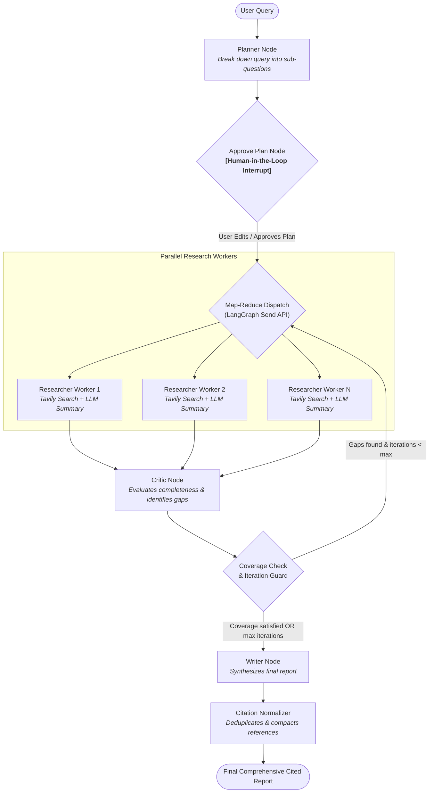

# 🔍 DeepResearch Agent

[](https://www.python.org/)
[](https://langchain-ai.github.io/langgraph/)
[](https://ai.google.dev/)
[](https://tavily.com/)
[](LICENSE)

An autonomous multi-agent deep research system powered by **LangGraph**, **Google Gemini**, and **Tavily AI Search**. It plans targeted queries, executes parallel web research, incorporates **human-in-the-loop** plan approval, evaluates research quality through a recursive **critic loop**, and generates structured reports with **strict verifiable citations**.

---

## 🌟 Key Features

- 🧠 **Dynamic Planning**: Deconstructs broad, complex queries into focused, highly-searchable sub-questions using structured LLM schema generation.
- 👤 **Human-in-the-Loop (HITL)**: Pauses execution via LangGraph interrupts so users can inspect, edit, add, or prune sub-questions before research kicks off.
- ⚡ **Map-Reduce Parallel Research**: Dispatches concurrent Tavily web searches and per-topic LLM summarization workers using LangGraph's dynamic `Send()` API.
- 🔁 **Self-Reflective Critic Loop**: Automatically evaluates research coverage and depth. Identifies knowledge gaps and dynamically routes back for follow-up research (configurable max iterations).
- 📌 **Zero-Hallucination Verified Citations**: Dedupes search citations globally across all parallel researchers, tracks inline references, and programmatically appends source links directly from real search payloads.
- 💾 **State Persistence**: Uses SQLite checkpointing (`SqliteSaver`) to pause, resume, and inspect execution states seamlessly across worker sessions.
- 🌐 **Full-Stack Interface**: Features both a clean terminal CLI and a modern FastAPI web app with live Server-Sent Events (SSE) streaming updates and Markdown rendering.

---

## 🏗️ Architecture & Workflow

The agent uses a cyclic StateGraph with human intervention checkpoints, dynamic fan-out workers, and conditional routing:



---

## 📂 Repository Structure

```text
DeepResearchAgent/
├── app/
│   ├── nodes/
│   │   ├── __init__.py
│   │   ├── planner.py         # Sub-question generation with structured Pydantic schema
│   │   ├── researcher.py      # Search extraction + context summarization worker
│   │   ├── critic.py          # Coverage critique, gap detection & recursion controls
│   │   └── writer.py          # Report synthesis & global citation renumbering
│   ├── tools/
│   │   ├── __init__.py
│   │   └── search.py          # Tavily search wrapper with error resiliency
│   ├── __init__.py
│   ├── api.py                 # FastAPI backend with Server-Sent Events (SSE)
│   ├── config.py              # Environment configuration & validation
│   ├── graph.py               # LangGraph workflow compilation & conditional edges
│   ├── llm.py                 # Google GenAI model setup & retries
│   ├── prompts.py             # Prompt engineering templates for each node
│   └── state.py               # ResearchState TypedDict with reducer operator.add
├── evals/
│   └── queries.json           # Sample evaluation topics across multiple domains
├── frontend/
│   ├── index.html             # Clean responsive UI
│   ├── script.js              # SSE consumer, plan review modal, and markdown renderer
│   └── style.css              # Minimal modern CSS design
├── .env.example               # Template for API credentials
├── .gitignore                 # Exclusion rules for secrets, DBs, and virtualenvs
├── main.py                    # Interactive CLI runner with interrupt pause/resume
├── requirements.txt           # Python dependencies
└── README.md                  # Project documentation
```

---

## 🚀 Quickstart Guide

### 1. Prerequisites

- Python 3.11+
- [Google Gemini API Key](https://aistudio.google.com/app/apikey)
- [Tavily AI Search API Key](https://tavily.com/)

### 2. Installation

Clone this repository and create a virtual environment:

```bash
git clone https://github.com/Khushee2023/DeepResearchAgent.git
cd DeepResearchAgent

python -m venv venv
# On Windows:
.\venv\Scripts\activate
# On Linux/macOS:
source venv/bin/activate
```

Install the dependencies:

```bash
pip install -r requirements.txt
```

### 3. Configure Environment Variables

Copy `.env.example` to `.env` and fill in your keys:

```bash
cp .env.example .env
```

Edit `.env`:

```env
GOOGLE_API_KEY=your_gemini_api_key_here
TAVILY_API_KEY=your_tavily_api_key_here
```

---

## 💻 Usage

### Option A: Interactive CLI

Run research directly in your terminal:

```bash
python main.py "Recent breakthroughs in solid-state battery technology for EVs"
```

1. The planner proposes 3–4 sub-questions.
2. The execution pauses for human input:
   - Hit **Enter** to approve the proposed plan as-is.
   - Or type modified sub-questions separated by `;` to customize the research angle.
3. Parallel workers fetch sources, critique findings, and output a complete Markdown report with citations.

---

### Option B: Web UI (FastAPI + SSE)

Launch the web interface:

```bash
uvicorn app.api:app --reload --port 8000
```

Open your browser at **[http://localhost:8000](http://localhost:8000)**:
- Enter your research topic.
- Review and edit the proposed sub-questions interactively in the web UI.
- Monitor live real-time progress steps via Server-Sent Events.
- Read and copy the formatted Markdown report directly from the interface.

---

## ⚙️ Configuration & Tuning

Adjust settings in [`app/config.py`](app/config.py) to tailor the system to your rate limits and research requirements:

| Variable | Default | Description |
|---|---|---|
| `MODEL_NAME` | `gemini-3.1-flash-lite` | Google Gemini model identifier |
| `TEMPERATURE` | `0.2` | Temperature for deterministic and factual summarization |
| `MAX_ITERATIONS` | `2` | Maximum loops the critic can trigger for gap-filling |
| `MAX_SUBQUESTIONS`| `4` | Number of sub-questions generated by the planner |
| `MAX_SEARCH_RESULTS` | `3` | Tavily search results retrieved per sub-question |
| `CHECKPOINT_DB` | `checkpoints.db` | SQLite persistence path for LangGraph checkpointer |

---

## 🛡️ Anti-Hallucination & Robustness

- **Programmatic Citation Injection**: Citations are mapped from actual URLs discovered during the web search phase. Citations are re-indexed across parallel streams, and the final list of references is dynamically built using verified source metadata rather than relying on LLM memory.
- **Defensive LLM Guardrails**: Worker prompts explicitly treat web snippets as untrusted external data to guard against indirect prompt injection.
- **Fault-Tolerant Workers**: Individual researcher sub-task failures are caught and logged without aborting the overall map-reduce graph execution.

---

## 📄 License

This project is licensed under the [MIT License](LICENSE).
